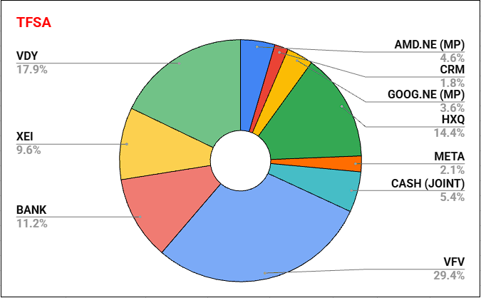
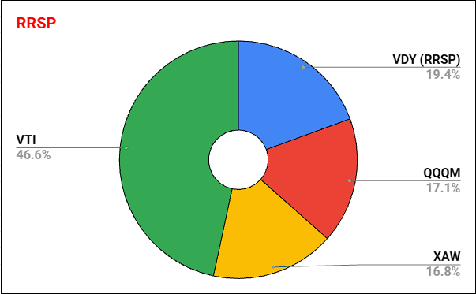
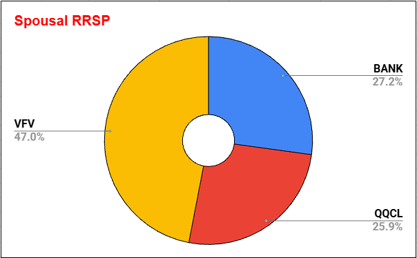
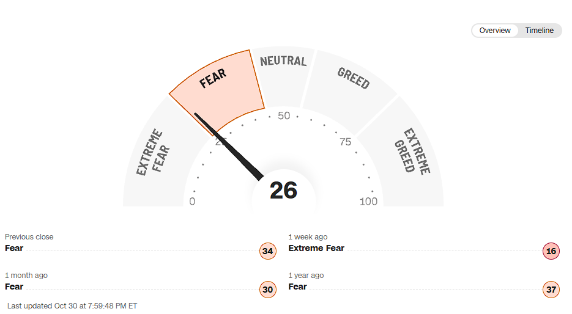

October is spooky season and let me tell you it really ended in spooky season this year. Is the AI bubble finally bursting or is this just another instance of an overreacting market? I still find the big swings we get these days extremely jarring at times, but, I'm better at than I used to be. You have to wonder when we are going to get a big swing down without an even bigger swing up. I sure hope that it doesn't happen the year that I decide to retire 😆. Since we are still early in our investing journey, started 2018-2019 and liquidated everything in 2021 technically lower markets right now just allows our money to purchase more shares! Even though I know that is true I still want to see the number go up into year end. Ok enough babbling on let's take a look at the market over the past month

## Major Indices VS My RRSP

Unlike the previous 4 rather flat months October was a bumpy road with the general trend being down for the US markets and the TSX60 generally trending up all month. **QQQM** was the biggest loser index ETF wise and single stock wise it curently feels like a battle for the local bottom between **AMD** and **GOOG**

  | **Ticker** | **Index**  | **2026-10-01** | **2026-10-31** | **Percentage Gain** |
  | ---------- | ---------- | -------------- | -------------- | ------------------- |
  | .INX       | S&P 500    | 7666.45        | 7580.07        | -1.13%              |
  | .IXIC      | Nasdaq 100 | 26871.6        | 25437          | -5.34%              |
  | .DJI       | Dow Jones  | 50926.56       | 51770.31       | 1.66%               |
  | TX60       | TSX 60     | 2069.14        | 2125.02        | 2.70%               |

  | **Ticker** | **RRSP ETFs**  | **2026-10-01** | **2026-10-31** | **Percentage Gain** |
  | ---------- | -------------- | -------------- | -------------- | ------------------- |
  | VDY        | FTSE Index CAD | 75.27          | 78.9           | 4.82%               |
  | XAW        | Many Indexes   | 59.4           | 57.36          | -3.43%              |
  | QQQM       | Nasdaq 100     | 305.57         | 284.34         | -6.95%              |
  | VTI        | Total US       | 375.18         | 371.57         | -0.96%              |

## My Moves
With the big dip here over the last couple of days I couldn't help myself but do some buying. Mostly in the spousal RRSP but I also did a small buy in the TFSA

My automated monthlies executed as normal:
- RESP small contributions each month to maximize the grant ($500) requiring ($2500) contributions in the year. These are put into XEQT. I actually found out that since our baby was born at the tail end of last year you actually carry that grant money forward!
- Work RRSP for both the match and pre-tax deductions is in an etf portfolio and is the ultimate handsoff account

### TFSA Buys & Sells
  - **BOUGHT**
    - **META** just a small amount from other holdings dividends. I'm thinking of increasing that position by 20% it will depend on how low it dips.

In terms of my single stocks not much has changed since last month aside from maybe holding **AMD** into the new year. I still do want to exit **CRM** by the end of year. My thinking on **AMD** has changed since some of the hyperscalers have commented on increasing spend again. If all of them agree I feel like I have to hold **AMD** for longer. As for the hyperscalers **GOOG** and **META** I'm starting to lean towards holding into next year and even potentially adding **AMZN**

### TFSA Breakdown

### RRSP Buys & Sells
So while I did a typical monthly contribution this time instead of holding more cash in my HISA, I deployed half yesterday and will deploy the other half next week. My thiking is if it goes up thats ok but if it goes down further and I have no cash left to buy I know I'll be sad. It may be silly, but, hey I know myself well enough to understand this is the best course of action for me 😄
- **BOUGHT**
  - 33% **VFV**
  - 33% **QQCL**
  - 33% **BANK**

### My RRSP Breakdown

- *percentages are calculated based on current market value, USD is converted to CAD based on google finance rate*

### Spousal RRSP Breakdown

### Dividend Increases and Decreases
- **CASH** 0.87 -> 0.84
  - interestingly **CASH** went back down but perhaps with the recent BoC rate increase we will see higher rates again 🤞
- Not a dividend increase but **AMD** (CDRs) had a 7 for 1 stock split. If it dips down some more I may have to add a little bit more to get more gains and also smooth out the share count 😆

## Fear and Greed Index
Talk about fear in the market this past week especially in the semiconductors. Intel's earnings report was terrible, but, to me it shouldn't make this big of a mess. Intel has struggled for a long time and was only pulled up in the hype in my opinion. Looking today the index is sitting just out of extreme fear at 26 with last weeks wildly low 16. Crypto is siting higher at 36 while just off the back of the $6.3billion dollar crypto hack just mindblowing!

## Wrap Up
October truly lived up to its spooky reputation with a bumpy ride and some sharp market dips, but it also presented some fantastic buying opportunities! While US tech indices took a hit, our steady Canadian holdings like VDY shone brightly, and we leaned into the volatility by deploying capital and scooping up shares on sale. Here’s to embracing market dips as a chance to buy more, keeping our long-term strategy rock solid, and finishing the year strong!

You can support me by:
- [Subscribing to my YouTube Channel](https://www.youtube.com/@FinancialFreedomAnOdyssey?sub_confirmation=1)
- [Using my WealthSimple referral link](https://my.wealthsimple.com/app/public/trade-referral-signup?code=VUGTXQ)
- Simply continuing to read my weekly posts here.

Cheers ☕
